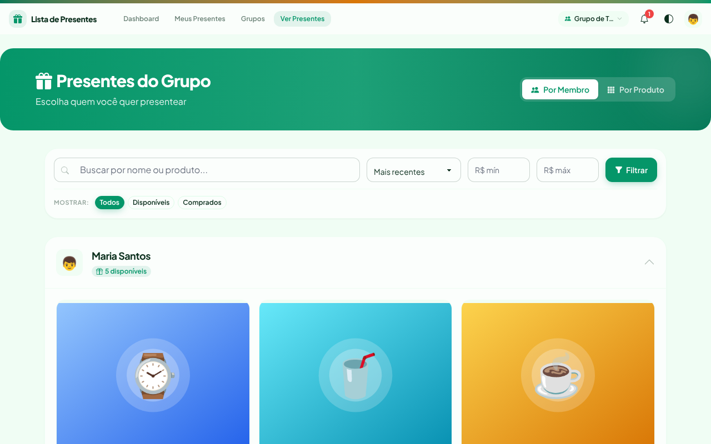
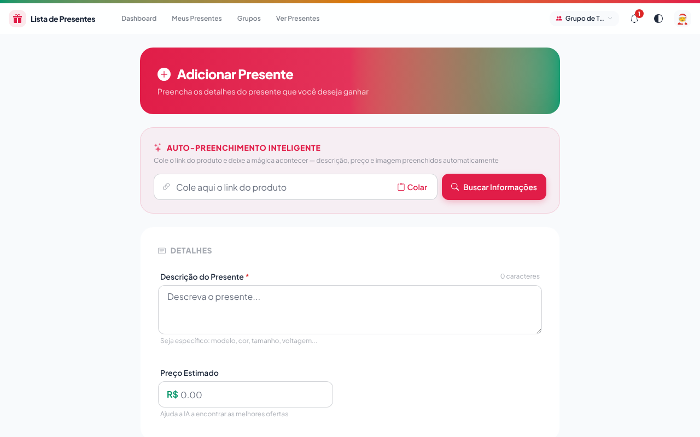
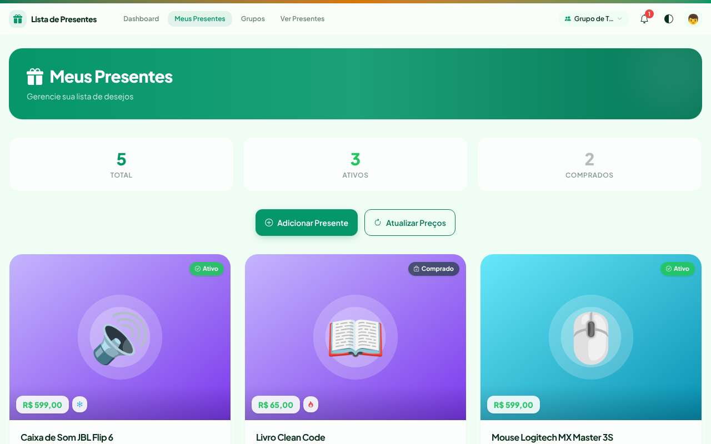
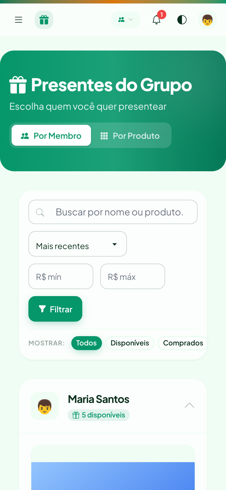
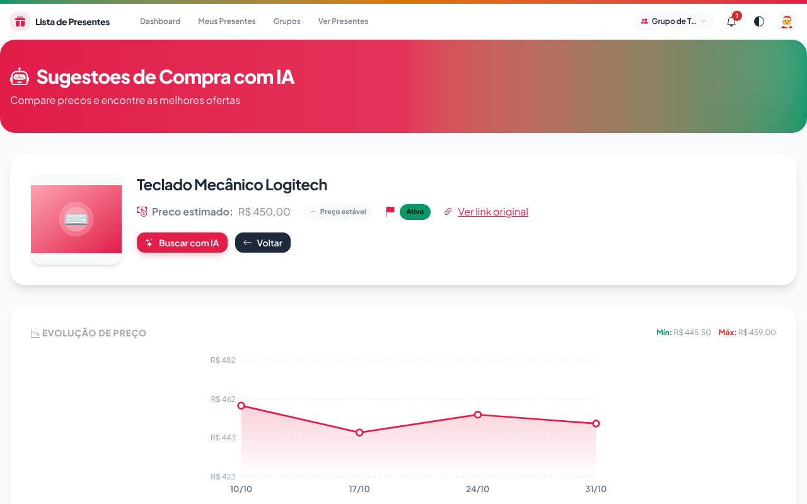

<div align="center">

# 🎁 Lista de Presentes

**A lista de presentes da família, sem presente repetido e sem estragar a surpresa.**

Cada pessoa monta a sua lista colando o link do produto. Os outros veem o que falta comprar, marcam o que compraram, e quem ganha não descobre o que vem.

[](https://lista-presentes-im4b.onrender.com)




</div>

---

## 💡 Por que usar

- 🎯 **Ninguém repete presente.** Quem compra marca o item, e o grupo inteiro vê que ele já foi.
- 🤫 **A surpresa continua surpresa.** Você recebe aviso de que um presente da sua lista foi comprado, mas não de quem comprou.
- 🔗 **Cadastro em segundos.** Cole o link da loja e a descrição, o preço e a foto aparecem sozinhos.
- 📉 **Preço acompanhado.** O sistema guarda o histórico de preço e indica quando o produto está mais barato.
- 📱 **Feito para o celular.** Instale como app e compartilhe um produto direto da loja para a sua lista.
- 👨‍👩‍👧‍👦 **Para cada turma, um grupo.** Família, amigos do trabalho, amigo secreto: cada grupo com a sua lista e o seu link de convite.

---

## 🚀 Como funciona

> Guia completo para quem vai usar: **[docs/USUARIO.md](docs/USUARIO.md)**

1. **Crie um grupo** e convide a família pelo link ou pelo WhatsApp.
2. **Monte a sua lista**: cole o link do produto (ou compartilhe do app da loja) e pronto.
3. **Escolha quem presentear**: veja as listas dos outros, compre e marque como comprado.

<p align="center">
  
  
</p>

---

## ✨ Funcionalidades

### 🎁 Lista de presentes
- Auto-preenchimento pelo link do produto: descrição, preço e foto
- Botão **Colar** e busca automática ao colar o link
- Lojas com leitura específica: **Amazon** (inclusive links `amzn.to`), **Mercado Livre** (API oficial), **Kabum** e **Decathlon**
- Outras lojas: leitura pelas meta tags e pelos dados estruturados da página (schema.org), com preço em reais mesmo em sites que mostram dólar
- Foto por upload, por link ou colando com Ctrl+V

### 💰 Preços
- Histórico e gráfico de evolução do preço de cada presente
- Indicador de "temperatura" do preço (🔥 caiu, ➖ estável, ❄️ subiu)
- Pesquisa semanal automática de preços
- Sugestões de onde comprar mais barato, com busca por IA

### 👨‍👩‍👧‍👦 Grupos e família
- Vários grupos por pessoa, com troca rápida no topo da tela
- Convite por link exclusivo ou WhatsApp
- Dados isolados por grupo
- Gerenciamento de membros

### 🔔 Avisos
- Notificações no site e **push no celular**
- E-mail de boas-vindas, de recuperação de senha e de "um presente seu foi comprado"

### 📱 No celular
- **PWA**: instale na tela inicial do Android, iOS ou computador
- **Compartilhar para a lista**: no Android, compartilhe um produto do app da loja direto para a Lista de Presentes

<p align="center">
  
  &nbsp;&nbsp;
  
</p>

### 🔐 Conta
- Login com e-mail ou com Google, Facebook, LinkedIn e Apple
- Temas claros e escuros

---

## 🛠️ Para desenvolvedores

**Stack:** Python 3.11+ · Django 5.1 · PostgreSQL · Tailwind CSS + daisyUI · Render · GitHub Actions

### Rodando localmente

```bash
git clone https://github.com/Maxwbh/Lista_de_Presentes.git
cd Lista_de_Presentes
python -m venv venv && source venv/bin/activate
pip install -r requirements.txt
USE_SQLITE=True python manage.py migrate
USE_SQLITE=True python manage.py populate_test_data   # dados de exemplo (senha: senha123)
USE_SQLITE=True python manage.py runserver
```

Acesse http://127.0.0.1:8000. Para PostgreSQL, Docker, deploy no Render, variáveis de ambiente, testes e solução de problemas, veja o **[guia de instalação](docs/development/INSTALACAO.md)**.

### Testes

```bash
python manage.py test presentes
```

O GitHub Actions roda os testes (Python 3.11 e 3.12), o lint e a verificação de segurança em cada PR.

### Documentação

| Assunto | Documento |
|---|---|
| Como usar o app (guia e perguntas frequentes) | [USUARIO.md](docs/USUARIO.md) |
| Arquitetura, modelos e endpoints internos | [ARQUITETURA.md](docs/development/ARQUITETURA.md) |
| Instalação, deploy, testes e manutenção | [INSTALACAO.md](docs/development/INSTALACAO.md) |
| Deploy no Render | [RENDER.md](docs/deployment/RENDER.md) |
| Docker | [DOCKER.md](docs/deployment/DOCKER.md) |
| Banco de dados (Supabase) | [SUPABASE.md](docs/database/SUPABASE.md) |
| Login social | [SOCIAL_LOGIN_CONFIG.md](docs/features/SOCIAL_LOGIN_CONFIG.md) |
| Grupos | [SETUP_GRUPOS.md](docs/features/SETUP_GRUPOS.md) |
| Keep-alive no Render Free | [KEEP_ALIVE.md](docs/features/KEEP_ALIVE.md) |
| Logs de leitura dos sites e issues automáticas | [SCRAPING_LOGS.md](docs/features/SCRAPING_LOGS.md) |
| Versionamento | [VERSIONAMENTO.md](docs/development/VERSIONAMENTO.md) |
| Como contribuir | [CONTRIBUTING.md](docs/development/CONTRIBUTING.md) |
| Histórico de mudanças | [CHANGELOG.md](CHANGELOG.md) |

---

## 🤝 Contribuindo

Sugestões, problemas e pull requests são bem-vindos.

- Encontrou um erro ou um site que não é lido direito? Abra uma [issue](https://github.com/Maxwbh/Lista_de_Presentes/issues).
- Quer contribuir com código? Veja o [CONTRIBUTING.md](docs/development/CONTRIBUTING.md) e o [código de conduta](CODE_OF_CONDUCT.md).

---

## 👥 Autor

**Maxwell Oliveira** (@maxwbh)

- 💼 Empresa: **M&S do Brasil LTDA**
- 🌐 Site: [msbrasil.inf.br](http://msbrasil.inf.br)
- 📧 Email: [maxwbh@gmail.com](mailto:maxwbh@gmail.com)
- 💻 GitHub: [@Maxwbh](https://github.com/Maxwbh/)
- 💼 LinkedIn: [linkedin.com/in/maxwbh](https://www.linkedin.com/in/maxwbh/)

---

---

## 📄 Licença

Distribuído sob a licença MIT. Veja o arquivo [LICENSE](LICENSE).

<div align="center">

**Gostou? Deixe uma ⭐ no repositório e compartilhe com a sua família!**

</div>
